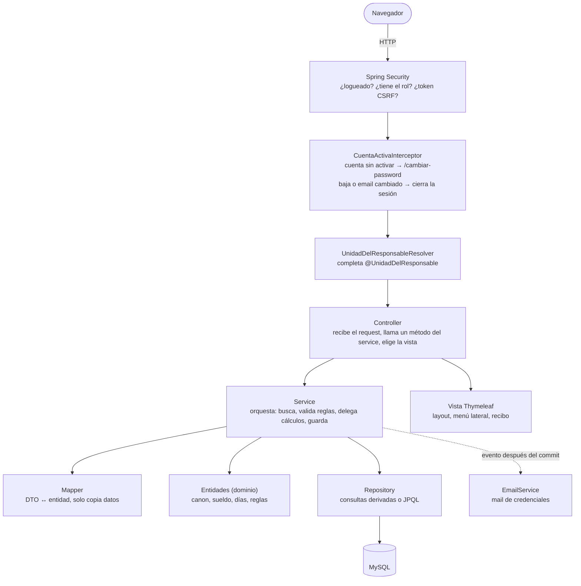
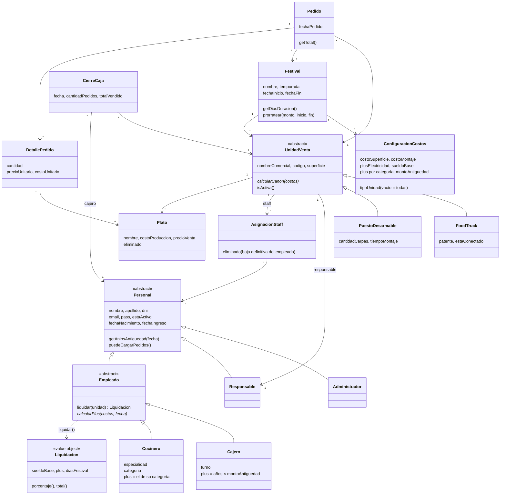
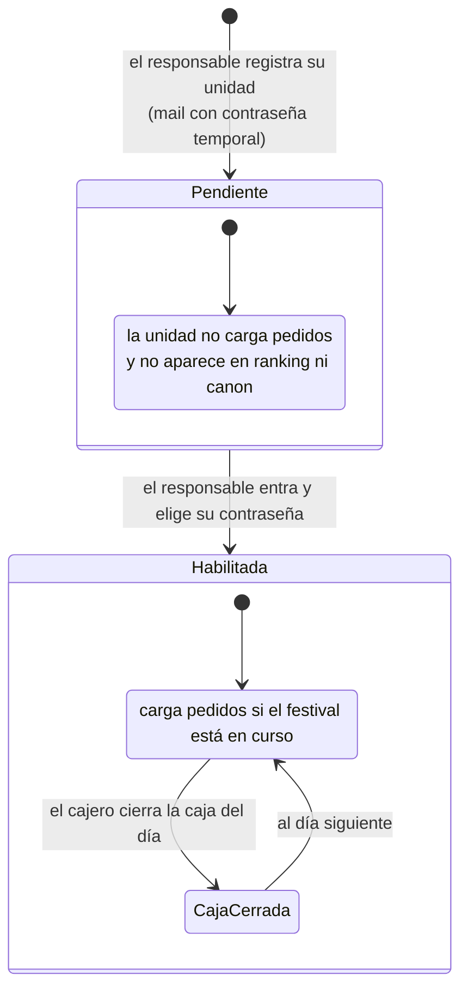
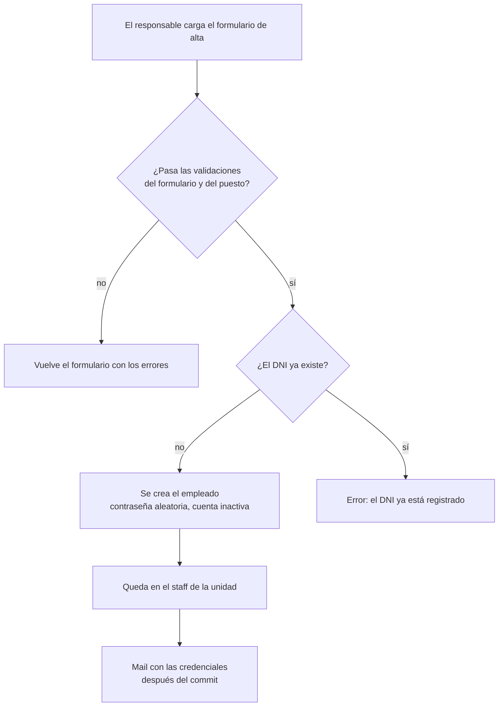
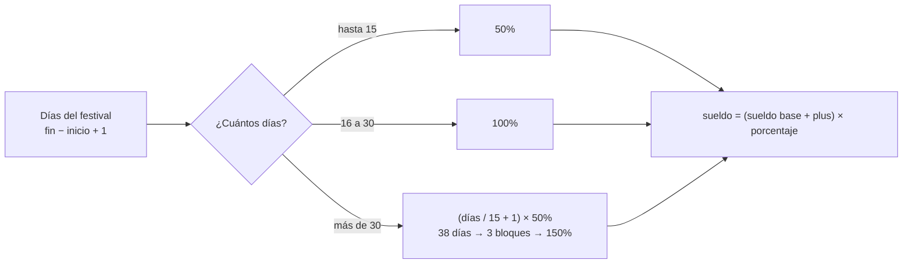
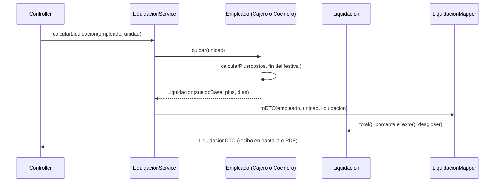
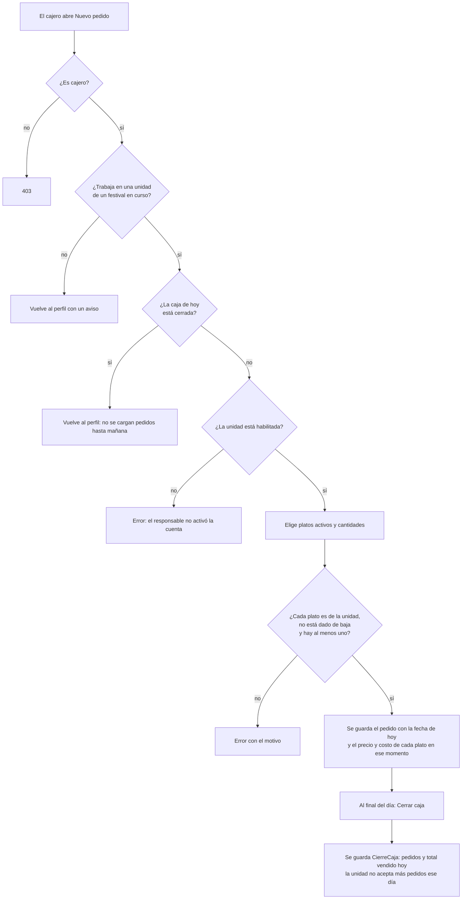

# Hito 2 — Festival Gastronómico (Grupo 14)

Aplicación web para gestionar festivales gastronómicos: unidades de venta (food trucks y puestos desarmables), su personal (cajeros y cocineros), pedidos, canon y liquidación de sueldos.

**Stack:** Java 21 · Spring Boot 4.1 · Spring Security · Spring Data JPA (Hibernate) · MySQL · Thymeleaf · Lombok · PDFBox · Spring Mail.

**Índice:** [Grupo](#grupo) · [Diagrama de clases](#diagrama-de-clases) · [Casos de uso](#casos-de-uso) · [1. Cómo levantarlo](#1-cómo-levantarlo) · [2. Arquitectura](#2-arquitectura) · [3. Modelo de datos](#3-modelo-de-datos) · [4. Flujos](#4-flujos) · [5. Seguridad](#5-seguridad) · [6. Mapa de endpoints](#6-mapa-de-endpoints) · [7. Notas](#7-notas)

Los diagramas están en [Mermaid](https://mermaid.js.org/): GitHub los muestra como gráficos.

## Grupo

**Grupo 14**

| Integrante | Usuario de GitHub |
|---|---|
| Ignacio Puig | [@ignacioDpuig](https://github.com/ignacioDpuig) |
| Leandro Kaul | [@Leandroidev](https://github.com/Leandroidev) |
| Joaquín Adra | [@joacoadra](https://github.com/joacoadra) |

Los commits de Ignacio Puig aparecen en GitHub vinculados a [@ichi1i1](https://github.com/ichi1i1), otra cuenta del mismo integrante.

## Diagrama de clases

[Poo2Hito2.dia](Poo2Hito2.dia) (se abre con [Dia](http://dia-installer.de/)).

## Casos de uso

Cada caso de uso se agregó a `main` con su propio Pull Request, que detalla lo que se creó.

| # | Caso de uso | Responsable | Rama | Pull Request |
|---|---|---|---|---|
| — | Arquitectura base (modelo, repositorios, datos de prueba) | Ignacio Puig | `ArquitecturaBaseIgnacioPuig` | [#1](https://github.com/ignacioDpuig/hito2-grupo14/pull/1) |
| 1 | Login y seguridad | Ignacio Puig | `CULoginSeguridadIgnacioPuig` | [#6](https://github.com/ignacioDpuig/hito2-grupo14/pull/6) |
| 2 | Ver festivales y unidades | Ignacio Puig | `CUVerFestivalesUnidadesIgnacioPuig` | [#3](https://github.com/ignacioDpuig/hito2-grupo14/pull/3) |
| 3 | Reporte de mayor canon | Ignacio Puig | `CUMayorCanonIgnacioPuig` | [#4](https://github.com/ignacioDpuig/hito2-grupo14/pull/4) |
| 4 | Registro de unidad y responsable | Ignacio Puig | `CURegistroUnidadResponsableIgnacioPuig` | [#5](https://github.com/ignacioDpuig/hito2-grupo14/pull/5) |
| 5 | Alta de empleado | Leandro Kaul | `CUAltaEmpleadoLeandroKaul` | [#7](https://github.com/ignacioDpuig/hito2-grupo14/pull/7) |
| 6 | Historial del empleado | Leandro Kaul | `CUHistorialEmpleadoLeandroKaul` | [#8](https://github.com/ignacioDpuig/hito2-grupo14/pull/8) |
| 7 | Modificación y baja de empleado | Leandro Kaul | `CUModificacionBajaEmpleadoLeandroKaul` | [#9](https://github.com/ignacioDpuig/hito2-grupo14/pull/9) |
| 8 | Liquidación de sueldos | Leandro Kaul | `CULiquidacionSueldosLeandroKaul` | [#10](https://github.com/ignacioDpuig/hito2-grupo14/pull/10) |
| 9 | Recibo de sueldo en PDF | Leandro Kaul | `CUReciboPDFLeandroKaul` | [#11](https://github.com/ignacioDpuig/hito2-grupo14/pull/11) |
| 10 | Alta de plato | Joaquín Adra | `CUAltaPlatoJoaquinAdra` | [#12](https://github.com/ignacioDpuig/hito2-grupo14/pull/12) |
| 11 | Modificación y baja de plato | Joaquín Adra | `CUModificacionBajaPlatoJoaquinAdra` | [#13](https://github.com/ignacioDpuig/hito2-grupo14/pull/13) |
| 12 | Carga de pedidos | Joaquín Adra | `CUPedidoJoaquinAdra` | [#14](https://github.com/ignacioDpuig/hito2-grupo14/pull/14) |
| 13 | Cierre de caja | Joaquín Adra | `CUCerrarCajaJoaquinAdra` | [#15](https://github.com/ignacioDpuig/hito2-grupo14/pull/15) |
| 14 | Reportes del responsable | Joaquín Adra | `CUReportesResponsableJoaquinAdra` | [#16](https://github.com/ignacioDpuig/hito2-grupo14/pull/16) |
| 15 | Ranking de unidades | Ignacio Puig | `CURankingUnidadesIgnacioPuig` | [#17](https://github.com/ignacioDpuig/hito2-grupo14/pull/17) |

### Documentación por integrante

Cada integrante documenta su área: cómo está construida, qué se valida y qué decisiones técnicas se tomaron.

| Integrante | Área | Documento |
|---|---|---|
| Ignacio Puig | Arquitectura base, login y seguridad, registro de unidades, festivales, mayor canon y ranking | [docs/IgnacioPuig.md](docs/IgnacioPuig.md) |
| Leandro Kaul | Alta, modificación y baja de empleados, historial, liquidación y recibo PDF | [docs/LeandroKaul.md](docs/LeandroKaul.md) |
| Joaquín Adra | Platos, pedidos, cierre de caja y reportes del responsable | [docs/JoaquinAdra.md](docs/JoaquinAdra.md) |

---

## 1. Cómo levantarlo

### Inicio rápido

Requisitos: JDK 21 y MySQL corriendo en `localhost:3306` con usuario `root` y contraseña `root`.

1. Crear la base (una sola vez):
   `mysql -u root -p -e "CREATE DATABASE IF NOT EXISTS hito2_db;"`
2. Levantar la app:
   - Linux / Mac: `./mvnw spring-boot:run`
   - Windows: `.\mvnw.cmd spring-boot:run`
3. Abrir http://localhost:8080 y entrar con `admin@admin` / `admin`.

No hace falta crear el archivo `.env`, salvo en estos dos casos:
- **Tu MySQL tiene otra contraseña:** crear un `.env` en la raíz con `DB_PASSWORD=tu_contraseña`.
- **Querés que se envíen los mails de credenciales:** completar `MAIL_USERNAME` y `MAIL_PASSWORD` (ver la tabla de abajo). Sin eso, el mail falla pero el alta se hace igual.

### Paso a paso

**Requisitos:** JDK 21, MySQL corriendo en `localhost:3306`. Maven viene incluido (`mvnw`).

```bash
# 1. Crear la base (una sola vez)
mysql -u root -p -e "CREATE DATABASE IF NOT EXISTS hito2_db;"

# 2. Credenciales: copiar la plantilla y completar el mail (el .env no se sube a GitHub)
cp .env.example .env

# 3. Levantar la app
./mvnw spring-boot:run
```

En Windows PowerShell, usa estos comandos:

```powershell
# Crear la base una sola vez (te pedirá la contraseña de MySQL)
mysql -u root -p -e "CREATE DATABASE IF NOT EXISTS hito2_db;"

# Crear el archivo local de configuración y completar sus valores
Copy-Item .env.example .env
notepad .env

# Iniciar la aplicación
.\mvnw.cmd spring-boot:run
```

**Variables de entorno.** Se pueden poner en el archivo `.env` de la raíz (lo lee `spring.config.import`) o exportarlas en la terminal:

| Variable | Default | Para qué |
|---|---|---|
| `MAIL_USERNAME` | — | Cuenta de Gmail que envía los mails. Sin esto el mail falla y el alta se hace igual. |
| `MAIL_PASSWORD` | — | **Contraseña de aplicación** de esa cuenta (no la normal): https://myaccount.google.com/apppasswords, requiere verificación en 2 pasos. |
| `DB_URL` / `DB_USERNAME` / `DB_PASSWORD` | `jdbc:mysql://localhost:3306/hito2_db` / `root` / `root` | Conexión a MySQL. |
| `APP_BASE_URL` | `http://localhost:8080` | URL que aparece en los mails. |

Abrir **http://localhost:8080**: página pública con los festivales y el login.

**Usuarios de prueba** (los carga [data.sql](src/main/resources/data.sql)):

| Email | Contraseña | Tipo | Entra a |
|---|---|---|---|
| `admin@admin` | `admin` | Administrador | `/admin/festivales` |
| `juan@email.com` | `pass123` | Responsable del Food Truck | `/responsable/dashboard` |
| `responsable@responsable` | `responsable` | Responsable del Puesto | `/responsable/dashboard` |
| `carlos@email.com` | `pass456` | Cocinero (Food Truck) | `/empleado/perfil` |
| `empleado@empleado` | `empleado` | Lavaplatos (Puesto) | `/empleado/perfil` |
| `sofia@email.com` | `sofia123` | Responsable del Food Truck del festival en curso | `/responsable/dashboard` |
| `cajero@cajero` | `cajero` | Cajero del festival en curso | `/empleado/perfil` |
| `martin@email.com` | `martin123` | Cocinero ayudante: trabajó en 2024 (Puesto) y trabaja hoy (Food Truck de Sofía) | `/empleado/perfil` |
| `rocio@email.com` | `rocio123` | Cajera **dada de baja** en el Puesto: no puede entrar | — |
| `pablo@email.com` | `pablo123` | Responsable del Puesto Sabores Andinos en el histórico de Otoño 2025 | `/responsable/dashboard` |
| `cocinero-<código>@festival.local` · `cajero-<código>@festival.local` | `pass456` | Cocinero y cajero de cada unidad de ejemplo (por ejemplo `cajero-ftverano02@festival.local`, que vende hoy en Primavera) | `/empleado/perfil` |

Hay tres festivales: el **Festival Gastronómico 2024** (con pedidos históricos), el **Festival Primavera 2026**, cuyas fechas se calculan desde el día en que arranca la app (empezó hace 10 días y termina en 30), y el **Festival de Otoño 2025** (del 1 al 16 de abril, con cinco unidades activas y ventas históricas). Primavera tiene un pedido de hoy, así que "festival en curso" y "cerrar caja" se pueden probar cualquier día con `cajero@cajero`.

Además, `data.sql` deja listos estos casos (los fija `DatosDePruebaTests`):
- **Costos por tipo:** en Primavera 2026 los Food Trucks pagan $700 el m² y tienen sueldo base de $110.000; el resto de las unidades usa la configuración general.
- **Empleado en dos festivales:** Martín tiene historial y un recibo por festival ($300.000 en 2024 y $315.000 en Primavera).
- **Bajas:** Rocío ya no aparece en la gestión ni puede entrar; su historial se conserva. El plato Provoleta está dado de baja y se puede reactivar.
- **Unidades de venta:** cada festival tiene cinco unidades. Las ventas de ejemplo dejan rentabilidad neta positiva en cada una; Otoño ya está cerrado y sus unidades tienen reportes históricos.
- Las cuentas responsables de las unidades de ejemplo usan `pass123`, salvo las cuentas documentadas con otra contraseña.

> ⚠️ `spring.jpa.hibernate.ddl-auto=create-drop`: **cada vez que arranca la app se borran y recrean todas las tablas** y se vuelve a ejecutar `data.sql`. Todo lo que cargues se pierde al reiniciar.

### Tests

```bash
./mvnw test
```

- `CalculosCaracterizacionTests`, `MappersTests`, `PedidoTests`: unitarios, no necesitan base. Fijan los cálculos del enunciado (liquidación, canon) y las reglas de dominio.
- `ReportesIntegracionTests`, `Hito2ApplicationTests`: levantan la app con los datos de `data.sql`.

Los tests usan una base **H2 en memoria** (`src/test/resources/application.properties`): no necesitan MySQL y no tocan la base de desarrollo. Por eso `data.sql` usa SQL que entienden los dos motores (`CURRENT_DATE - INTERVAL '10' DAY`) y no hace `USE`: la base es la del `DB_URL`.

---

## 2. Arquitectura

Arquitectura en capas de Spring MVC. Cada capa tiene una sola responsabilidad:



### Paquetes (`com.grupo14.hito2`)

| Paquete | Qué contiene |
|---|---|
| `configuration` | Seguridad (`SecurityConfiguration`), interceptor de cuenta activa, `@UnidadDelResponsable` y su resolver, `ErrorHandler`, `VistaComunAdvice` y las constantes de `Roles`. |
| `controllers` | Un controller por área (`Home`, `Admin`, `Responsable`, `Empleado`, `Password`). No tienen lógica. |
| `services` | Orquestan los casos de uso. `CuentaService` maneja los usuarios (alta con credenciales, activación, email y DNI únicos) y `EmpleadoService` el staff de cada unidad, delegando en `CuentaService` la creación del usuario. `UsuarioDetailsService` es el que usa Spring Security para el login. |
| `mappers` | `PersonalMapper`, `UnidadVentaMapper`, `LiquidacionMapper`. Pasan datos entre DTOs y entidades. |
| `entities` | Entidades JPA con su comportamiento, y el value object `Liquidacion`. |
| `dtos` | Datos de formularios (`Crear...DTO`) y reportes que no persisten (`LiquidacionDTO`, `RankingUnidadDTO`, `ReporteMayoresCanonDTO`, `PlatoDTO`). |
| `repositories` | Interfaces `JpaRepository`. |
| `events` | `CredencialesGeneradasEvent`: dispara el mail de credenciales después de guardar. |
| `exceptions` | `ReglaDeNegocioException` (regla rota, el mensaje es para el usuario) y `NoEncontradoException` (responde 404). |
| `enums` | `CategoriaCocinero`, `TipoPersonal`, `TipoUnidad`. |
| `resources/templates/fragments/layout.html` | Layout común: `head(titulo)`, `menu(seccion)` (**menú lateral** con los links de cada rol, marca la página actual, muestra al usuario y el logout; en celulares se despliega desde una barra superior), `monto(valor)`, `erroresFormulario` y `mensajes` (se pueden cerrar; los de éxito se ocultan solos). `VistaComunAdvice` le pasa la ruta actual y el usuario logueado. |
| `resources/templates/fragments/iconos.html` | Íconos SVG de trazo (estilo Lucide) definidos una vez por página: `<svg class="icono"><use href="#i-home"/></svg>`. |
| `resources/templates/fragments/recibo.html` | Recibo de haberes en pantalla, con el mismo contenido que el PDF. Lo usan el responsable (`/responsable/sueldos/{id}`) y el empleado (`/empleado/recibos`). |
| `resources/static/css/app.css` | **Única hoja de estilos** de toda la app: colores, radios y sombras como variables CSS, paleta clara con el violeta como color principal, menú lateral, métricas, tablas, formularios (los obligatorios llevan `*`) y diseño adaptable al celular. No depende de ningún CDN. |

### Patrones usados

- **Polimorfismo en lugar de `instanceof`:** cada unidad sabe calcular su canon (`calcularCanon`) y cada empleado su plus (`calcularPlus`).
- **Template Method:** `Empleado.liquidar(unidad)` arma el sueldo igual para todos y cada subclase solo define su plus (`calcularPlus`).
- **Information Expert:** cada dato se calcula donde está la información: `Festival.getDiasDuracion()`, `Personal.getAniosAntiguedad(fecha)`, `Pedido.agregarDetalle()`.
- **Value Object:** `Liquidacion` tiene los números del sueldo y la fórmula del enunciado en un solo lugar.
- **Factory:** `TipoPersonal.nuevoEmpleado()` crea el subtipo según el tipo elegido en el formulario (un tipo inválido da error) y la subclase valida sus datos con `actualizarDatosDelPuesto`. Las unidades igual: `TipoUnidad.nuevaUnidad()` y `actualizarDatosDelTipo`.
- **Observer:** el alta publica `CredencialesGeneradasEvent` y `EmailService` manda el mail **recién cuando la transacción se confirma**.
- **Argument resolver:** `@UnidadDelResponsable UnidadVenta unidad` en un controller trae la unidad del responsable logueado (`UnidadDelResponsableResolver`). La búsqueda por email está en un solo lugar y los services reciben la unidad, sin saber nada del login.
- **Dinero en `BigDecimal`:** precios, costos, canon, sueldos, ventas y reportes. Con `double` las sumas acumulan errores de redondeo (0,1 + 0,2 = 0,30000000000000004); `BigDecimal` es exacto. En la base son `DECIMAL(12,2)` y el único redondeo es al prorratear entre fechas (`Festival.prorratear`, al centavo).
- **Excepción de negocio:** las reglas rotas (DNI repetido, caja cerrada, canon negativo...) lanzan `ReglaDeNegocioException`; los controllers atrapan solo esa para mostrar el mensaje en el formulario, así un error del programa no se muestra como si fuera un dato mal cargado.
- **Transacciones:** las altas (`crearUnidadVenta`, `crearEmpleado`) son `@Transactional`: si algo falla no queda nada guardado a medias ni se envía el mail.

---

## 3. Modelo de datos



**Herencia JOINED:** una tabla por clase, unidas por el mismo `id`. Por eso en `data.sql` un cocinero se inserta en `personal`, `empleado` y `cocinero`.

Ningún monto está escrito en el código: todos salen de `ConfiguracionCostos` del festival.

**Costos por tipo de unidad.** Cada festival puede tener una configuración **general** (`tipoUnidad` vacío, vale para todas las unidades) y otras **para un tipo** (`FoodTruck` o `PuestoDesarmable`). Cada unidad usa la de su tipo si existe y si no la general (`Festival.getConfiguracionCostos(tipo)`, `UnidadVenta.getConfiguracionCostos()`). Se aplica al canon y a la liquidación: un empleado cobra con el sueldo base del tipo de su unidad.

---

## 4. Flujos

### Registro de unidad con responsable (público)

Cada responsable registra **su propia unidad** en la página pública `/registro` (link en el inicio y en el login) → `UnidadVentaService.crearUnidadVenta`. Del responsable se piden solo **nombre, apellido y email**: no se cargan DNI ni fecha de nacimiento (quedan vacíos). Se genera su usuario: el **email** y una **contraseña temporal**. Cada responsable tiene una sola unidad; el administrador ya no registra unidades, solo las consulta.
1. `UnidadVentaMapper` arma el `FoodTruck` o `PuestoDesarmable` y los datos del responsable.
2. `CuentaService.crearResponsable`: contraseña aleatoria encriptada con BCrypt, cuenta **inactiva**, roles `RESPONSABLE` + `EMPLEADO`.
3. Se asigna el festival y el responsable (queda también en el staff) y se guarda.
4. Al confirmarse la transacción se manda el mail con usuario y contraseña temporal.

**Estados de la cuenta y de la unidad:**



**Habilitación.** La cuenta se activa cuando la persona entra con la contraseña del mail y elige la suya: así se verifica que el email es suyo. Una **unidad está habilitada solo si su responsable activó la cuenta** (`UnidadVenta.isActiva`); mientras tanto figura "Pendiente" para el admin y **no puede cargar pedidos** (`Pedido.nuevo`). Los empleados pasan por la misma activación con su propio mail.

### Login y activación de cuenta

1. `POST /loginprocess` → `UsuarioDetailsService` busca por email y Spring compara con BCrypt.
2. `/dashboard` redirige según el rol: admin → `/admin/festivales`, responsable → `/responsable/dashboard`, empleado → `/empleado/perfil`.
3. Si la cuenta está inactiva (usuario recién creado), `CuentaActivaInterceptor` lo manda a `/cambiar-password` **desde cualquier URL**, hasta que elija su contraseña.
4. `CuentaActivaInterceptor` también **cierra la sesión** en el siguiente click si al usuario le cambiaron el email (su usuario) o lo dieron de baja, y lo manda a `/login?sesionCerrada`.

### Modificación de la unidad (responsable)

`/responsable/unidad` → `UnidadVentaService.modificarUnidad`. El responsable edita **solo su unidad**: nombre comercial, superficie y los datos del tipo (patente y conexión del food truck; carpas y tiempo de montaje del puesto). El **código y el tipo no cambian**, porque identifican la unidad y definen el cálculo del canon. Cada subclase valida y actualiza lo suyo con `actualizarDatosDelTipo(DatosUnidad)`, igual que los empleados con `DatosPuesto`.

### Alta de empleado (responsable)

`/responsable/empleados/crear` → `EmpleadoService.crearEmpleado`. El empleado queda **siempre en la unidad del responsable logueado** (no se elige en el formulario). Recibe por mail su usuario y una contraseña aleatoria.

Si el DNI ya está registrado, el alta se rechaza. Una vez dado de baja, el empleado no se puede reactivar ni reincorporar; si se lo vuelve a contratar, se crea una cuenta nueva desde cero.



### Modificación y filtros de empleados (responsable)

- **Listado con filtros** (`/responsable/empleados`): por texto (nombre, apellido o email) y por tipo (cocinero o cajero). Solo muestra empleados activos; las bajas no aparecen en la gestión (`EmpleadoRepository.filtrar`).
- **Modificación** (`/responsable/empleados/{id}/editar`): datos personales, fechas y datos del puesto. El tipo no cambia; cada subclase actualiza lo suyo con `actualizarDatosDelPuesto` (el cocinero exige categoría, el cajero turno). Email y DNI no pueden quedar repetidos.

### Cómo se calcula el sueldo

```
sueldo = (sueldo base + plus) × porcentaje por duración del festival
```

| Parte | De dónde sale | Clase |
|---|---|---|
| Sueldo base | Lo fija el festival para el tipo de unidad | `ConfiguracionCostos` |
| Plus del cocinero | El de su categoría (cocinero, ayudante, lavaplatos) | `Cocinero.calcularPlus` |
| Plus del cajero | Monto por año × años de antigüedad **al terminar el festival** | `Cajero.calcularPlus` |
| Porcentaje | Hasta 15 días 50%; de 16 a 30 días 100%; más de 30, 50% por cada bloque de 15 días contando `días / 15 + 1` bloques | `Liquidacion.porcentaje` |





El recorrido es corto: `LiquidacionService` le pide al empleado `empleado.liquidar(unidad)`, que devuelve una `Liquidacion` con el sueldo base, el plus y los días; `Liquidacion.total()` aplica la fórmula y `LiquidacionMapper` copia esos números al recibo.

Ejemplo: lavaplatos en un festival de 38 días → 38 / 15 + 1 = 3 bloques = 150% → (100.000 + 50.000) × 150% = **$225.000**.

### Sueldos del personal (responsable)

`/responsable/sueldos`: liquidación de cada empleado de la unidad en su festival (cargo, sueldo base, plus y total) y el total de la unidad, con el recibo de cada uno en pantalla y en PDF. Solo se pueden ver empleados de la propia unidad.

### Baja de empleados y platos (responsable)

La baja de un empleado marca como inactivas todas sus asignaciones (`AsignacionStaff.eliminado`): deja de aparecer en las listas de gestión y pierde acceso. No se puede reactivar ni reincorporar la cuenta anterior. Se conservan sus datos históricos y liquidaciones, pero se liberan su DNI y email: si se lo vuelve a contratar se crea un empleado nuevo, sin vínculo con su cuenta anterior. El sueldo del trabajo previo sigue restándose en la rentabilidad neta.
- La baja de un plato marca `eliminado = true`; no se ofrece ni se acepta en pedidos nuevos, pero sus ventas anteriores siguen contando en los reportes. Los platos se pueden reactivar.
- Un plato dado de baja no se ofrece ni se acepta en pedidos nuevos, pero sus ventas anteriores siguen contando en los reportes.

### Modificación de platos (responsable)

`/responsable/platos/{id}/editar`: nombre, costo y precio. Cada `DetallePedido` guarda el **precio y el costo del momento de la venta** (`precioUnitario`, `costoUnitario`), y todos los reportes suman con esos valores. Por eso cambiar un precio solo afecta a los pedidos nuevos: la recaudación y la rentabilidad de lo ya vendido no cambian.

`eliminado` (de la asignación o del plato) es distinto de `estaActivo`, que indica si el usuario ya eligió su contraseña.

### Reportes del responsable

`/responsable/reportes` → `ReporteUnidadService`. Cada unidad pertenece a un solo festival, así que los reportes son siempre sobre ese:
- **Recaudación** (`ReporteVentaDTO`): total vendido, costo de los platos vendidos, cantidad de pedidos y ganancia bruta. Una sola query (`resumirVentas`).
- **Plato estrella** (`PlatoDTO`): el plato con más unidades vendidas (un pedido de 50 pizzas suma 50). Si empatan, el primero por nombre, para que el resultado no sea al azar.
- **Rentabilidad neta** (`RentabilidadDTO`): ventas − costo de los platos − sueldos del staff − canon.

Con los datos de prueba, el Food Truck de Juan da: $1.500.000 vendido − $446.000 de platos − $375.000 de sueldos − $14.750 de canon = **$664.250**.

**Rentabilidad entre fechas** (`/responsable/reportes/fechas`, `RentabilidadEntreFechasDTO`): las fechas tienen que estar dentro del festival. Ventas y costo de platos son los del período; sueldos y canon se prorratean por los días que cubre (`Festival.prorratear`, redondeado al centavo). Ejemplo: del 20/12 al 21/12 son 2 de 38 días → $860.000 − $258.000 − 2/38 × $375.000 − 2/38 × $14.750 = **$581.486,84**.

### Empleado: festival en curso, historial y cierre de caja

- **Perfil:** muestra el festival y la unidad donde trabaja hoy (`Festival.estaEnCurso`), o avisa que no tiene uno.
- **Historial** (`/empleado/historial`): todos los festivales y unidades donde trabajó.
- **Cerrar caja** (`/empleado/cerrar-caja`, **solo cajeros**): muestra la cantidad de pedidos y el total vendido hoy por la unidad del festival en curso (`CierreCajaDTO`). Al cerrarla se guarda un `CierreCaja` (fecha, unidad, cajero, pedidos y total) y **la unidad no acepta más pedidos ese día**. Se cierra una sola vez por día (restricción única unidad + fecha) y se ve el historial de cierres. Sin festival en curso vuelve al perfil con un aviso.

### Pedido (empleado)

`/empleado/pedidos/crear` muestra los platos activos de su unidad **del festival en curso**; si no trabaja en ninguno, vuelve al perfil con un aviso. `Pedido.nuevo` le pone la fecha del día y rechaza el pedido si la unidad no está habilitada o su festival no está en curso; `agregarDetalle` rechaza platos de otra unidad o dados de baja y suma cantidades si el plato se repite. Un pedido sin platos da error.



Solo los **cajeros** cargan pedidos y cierran la caja (`Personal.puedeCargarPedidos`, que el `Cajero` redefine); otro empleado recibe un 403. Con la caja del día cerrada no se cargan más pedidos. Todos los empleados ven los pedidos de su unidad en `/empleado/pedidos`, con el detalle y el total de cada uno.

Con los datos de prueba pueden cargar pedidos los cajeros del Festival Primavera 2026, el único en curso: `cajero@cajero` y los cajeros de las unidades de ejemplo de ese festival (`cajero-ftverano02@festival.local`, `cajero-pdprima002@…`, `cajero-ftprimav03@…`, `cajero-pdprimav03@…`).

### Liquidación y recibo PDF (empleado)

`/empleado/recibos` muestra un recibo por festival en el que trabajó; `/empleado/recibos/descargar/{festivalId}` lo descarga en PDF.

**El recibo** (en pantalla y en PDF, `PDFService`) se identifica con el **id y el código de la unidad de venta** que paga el sueldo, e incluye los datos del **empleador** (unidad, tipo y su **responsable**: nombre, DNI y email), del **empleado** (DNI, cargo, ingreso, email), el detalle de la liquidación (sueldo base, plus, porcentaje según la duración), el total neto y lugar para las firmas. El empleado sale de la sesión, así que nadie puede ver el recibo de otro, y un festival donde no trabajó da 404. Responsables y admin no tienen recibos.

Cálculo (`Empleado.liquidar` + `Liquidacion`, ver "Cómo se calcula el sueldo"):
- Días del festival = días entre inicio y fin **+ 1**.
- La **antigüedad** del cajero es la que tenía **el día que terminó el festival** (`Personal.getAniosAntiguedad(fecha)`): el recibo de un festival no cambia con el paso del tiempo, y si ingresó después del festival no suma antigüedad en ese.
- Hasta 15 días: 50% · de 16 a 30: 100% · más de 30: `(int(días/15) + 1) × 50%`.
- Ejemplo: lavaplatos, festival de 38 días → 3 × 50% × ($100.000 + $50.000) = **$225.000**.

### Reportes (admin)

- **Ranking y recaudación** (`/admin/ranking`): el **Reporte de Recaudación** del festival (`ReporteVentaDTO`: total vendido, costo de platos, pedidos y ganancia bruta de todas sus unidades) y debajo las unidades **habilitadas** ordenadas por recaudación. Las pendientes de activación no aparecen porque todavía no pueden vender.
- **Mayor canon** (`/admin/canon-reporte`): las `x` unidades **habilitadas** que más pagan (x entre 1 y 20), con `ReporteMayoresCanonDTO`. Igual que en el ranking, las pendientes de activación no aparecen.
  - Food Truck: `superficie × costoSuperficie + plusElectricidad` si está conectado.
  - Puesto: `superficie × costoSuperficie − tiempoMontaje × costoMontaje`.

### Validaciones de carga

**Formularios (Bean Validation).** Si algo no cumple, el formulario vuelve con la lista de errores y lo ya cargado.

| Formulario | Validaciones |
|---|---|
| Registro de unidad (`CrearUnidadVentaDTO`) | Campos obligatorios, superficie > 0, nombre, apellido y email válido del responsable y **código de unidad** (`@CodigoUnidad`) |
| Patente (`@Patente`, alta y modificación de unidad) | Formato viejo **ABC123** o Mercosur **AB123CD**; se guarda en mayúsculas, sin espacios ni guiones |
| Modificación de empleado (`EditarEmpleadoDTO`) | Las mismas que el alta, más categoría o turno según el tipo |
| Alta de empleado (`CrearEmpleadoDTO`) | Campos obligatorios, **DNI de 7 u 8 dígitos**, email válido, **mayor de edad** y nacido desde 1900, fecha de ingreso no futura y **de cuando ya era mayor de edad** (`@IngresoMayorDeEdad`) |
| Alta y modificación de plato (`CrearPlatoDTO`) | Nombre obligatorio, costo ≥ 0, precio > 0 y **igual o mayor al costo**; el **nombre no se repite** en la unidad (sin importar mayúsculas; si el repetido está dado de baja, avisa que se puede reactivar) |
| Activar cuenta (`/cambiar-password`) | Contraseña de **al menos 8 caracteres** (no solo espacios) y **confirmación** igual |

**Código de unidad** (`validation/CodigoUnidadValidator`): 10 caracteres, `FT` (Food Truck) o `PD` (Puesto Desarmable) + 8 letras mayúsculas o números, y el prefijo tiene que coincidir con el tipo elegido. Ej: `FTSDELSUR1`, `PDPARRLL01`.

**Reglas de negocio (services).**
- Email, DNI, código de unidad y **patente** no se pueden repetir.
- Un cocinero necesita categoría y un cajero, turno.
- Un food truck necesita patente y un puesto, carpas y tiempo de montaje.
- Una unidad solo se registra en un festival **en curso o futuro**: en uno terminado nunca podría vender (el formulario tampoco ofrece los terminados).
- El **canon no puede dar negativo** (`UnidadVenta.validarCanon`), ni en el alta ni al modificar la unidad: un puesto de 1 m² con 100 min de montaje daría 500 − 1.000 = −$500.
- Un pedido siempre tiene la fecha del día, solo se carga en una unidad habilitada **de un festival en curso**, no acepta platos de otra unidad ni dados de baja, y no puede estar vacío.
- La rentabilidad entre fechas exige un rango válido dentro del festival.
- `Festival` rechaza un período con inicio posterior al fin al guardarse por JPA.

**Errores.** `ErrorHandler` (`@ControllerAdvice`) muestra `error.html` con 404 para lo que no existe y 400 para datos inválidos; Spring Boot usa la misma página para URLs inexistentes.

---

## 5. Seguridad

Archivo: [SecurityConfiguration.java](src/main/java/com/grupo14/hito2/configuration/SecurityConfiguration.java)

| URL | Quién puede entrar |
|---|---|
| `/`, `/login` | Todos |
| `/admin/**` | `ADMIN` |
| `/responsable/**` | `RESPONSABLE` |
| `/empleado/**` | `EMPLEADO`, `RESPONSABLE` o `ADMIN` |
| Cualquier otra | Usuario logueado |

- Contraseñas con **BCrypt**.
- **CSRF activo**: Thymeleaf agrega el token solo en los formularios con `th:action`.
- Sin sesión → 302 a `/login`. Sin el rol → 403.

---

## 6. Mapa de endpoints

| Método | URL | Rol | Qué hace |
|---|---|---|---|
| GET | `/` | público | Festivales + login |
| GET / POST | `/registro` | público | Registro de unidad + responsable (nombre, apellido y mail) |
| GET | `/login` | público | Pantalla de login |
| POST | `/loginprocess` | público | Login (Spring Security) |
| POST | `/logout` | logueado | Cerrar sesión |
| GET | `/dashboard` | logueado | Redirige según el rol |
| GET / POST | `/cambiar-password` | logueado, cuenta inactiva | Activar cuenta (con la cuenta ya activa redirige a `/dashboard`) |
| GET | `/admin/festivales` | ADMIN | Festivales |
| GET | `/admin/unidades/{festivalId}` | ADMIN | Unidades de un festival |
| GET | `/admin/ranking` | ADMIN | Ranking por recaudación |
| GET | `/admin/canon-reporte` | ADMIN | Unidades con mayor canon |
| GET | `/responsable/dashboard` | RESPONSABLE | Panel |
| GET | `/responsable/empleados` | RESPONSABLE | Empleados de su unidad |
| GET | `/responsable/empleados?texto=&tipoPersonal=` | RESPONSABLE | Empleados activos de su unidad con filtros |
| GET / POST | `/responsable/unidad` | RESPONSABLE | Modificación de su unidad |
| GET / POST | `/responsable/empleados/crear` | RESPONSABLE | Alta de empleado |
| GET / POST | `/responsable/empleados/{id}/editar` | RESPONSABLE | Modificación de empleado |
| POST | `/responsable/empleados/{id}/eliminar` | RESPONSABLE | Dar de baja definitivamente al empleado |
| GET | `/responsable/platos` | RESPONSABLE | Platos de su unidad |
| GET / POST | `/responsable/platos/crear` | RESPONSABLE | Alta de plato |
| GET / POST | `/responsable/platos/{id}/editar` | RESPONSABLE | Modificación de plato |
| POST | `/responsable/platos/{id}/eliminar` · `/reactivar` | RESPONSABLE | Baja lógica / reactivación de plato |
| GET | `/responsable/sueldos` | RESPONSABLE | Liquidación de los empleados de su unidad |
| GET | `/responsable/sueldos/{empleadoId}` | RESPONSABLE | Recibo en pantalla de un empleado de su unidad |
| GET | `/responsable/sueldos/{empleadoId}/pdf` | RESPONSABLE | Recibo en PDF de un empleado de su unidad |
| GET | `/responsable/reportes` | RESPONSABLE | Recaudación, plato estrella y rentabilidad neta |
| GET | `/responsable/reportes/fechas` | RESPONSABLE | Rentabilidad neta entre dos fechas |
| GET | `/empleado/perfil` | EMPLEADO+ | Panel |
| GET | `/empleado/historial` | EMPLEADO+ | Festivales y unidades donde trabajó |
| GET | `/empleado/cerrar-caja` | EMPLEADO+ (solo cajero) | Total vendido hoy e historial de cierres |
| POST | `/empleado/cerrar-caja` | EMPLEADO+ (solo cajero) | Cerrar la caja del día |
| GET | `/empleado/recibos` | EMPLEADO+ | Recibos de sueldo |
| GET | `/empleado/recibos/descargar/{festivalId}` | EMPLEADO+ | Recibo en PDF |
| GET | `/empleado/pedidos` | EMPLEADO+ | Pedidos de su unidad |
| GET / POST | `/empleado/pedidos/crear` | EMPLEADO+ (solo cajero) | Alta de pedido |

---

## 7. Notas

- **Mail:** sin `MAIL_USERNAME` / `MAIL_PASSWORD` el envío falla con "Authentication failed"; el error queda en el log y el alta se hace igual.
- Si un festival tuviera más de una `ConfiguracionCostos` para el mismo tipo (o más de una general), se usa la primera cargada (menor id).
