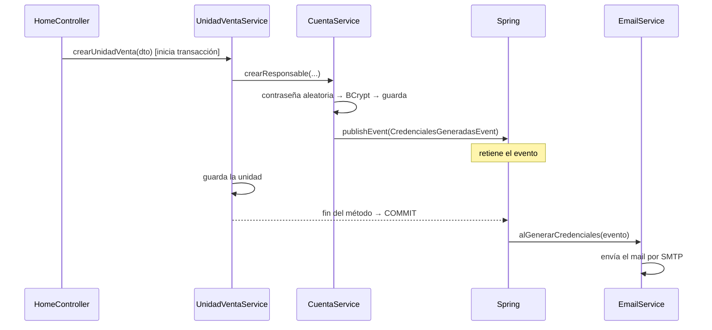

# Área A — Acceso, registro y reportes del administrador

**Autor:** Ignacio Puig · **Grupo 14** · Hito 2 — Festival Gastronómico

Este documento describe la parte del sistema a mi cargo: cómo está construida, qué decisiones técnicas se tomaron y por qué.

| Caso de uso | PR | Quién lo usa |
|---|---|---|
| Arquitectura base | #1 | Todo el sistema |
| Login y seguridad | #6 | Todos los usuarios |
| Ver festivales y unidades | #3 | Público / Administrador |
| Mayor canon | #4 | Administrador |
| Registro de unidad y responsable | #5 | Público (responsable sin cuenta) |
| Ranking de recaudación | #17 | Administrador |

**Índice:** [1. Arquitectura](#1-arquitectura-base) · [2. Login y seguridad](#2-login-y-seguridad) · [3. Registro](#3-registro-de-unidad-y-responsable) · [4. Festivales y unidades](#4-ver-festivales-y-unidades) · [5. Mayor canon](#5-mayor-canon) · [6. Ranking](#6-ranking-de-recaudación) · [7. Reutilización](#7-qué-reutilizan-los-otros-casos-de-uso) · [8. Demo](#8-guion-de-demo)

---

## 1. Arquitectura base

### Capas

```
Navegador ──► Controller ──► Service ──► Repository ──► MySQL
              (HTTP, vistas)  (reglas)    (Spring Data)
                  │
                  ▼
              Thymeleaf (HTML)
```

| Paquete | Responsabilidad |
|---|---|
| `controllers` | Recibe el request, valida el formulario (`@Valid`), llama al servicio y elige la vista. Sin lógica de negocio. |
| `services` | Reglas de negocio y transacciones (`@Transactional`). |
| `repositories` | Acceso a datos con Spring Data JPA (consultas derivadas y JPQL). |
| `entities` | Modelo de dominio. Las entidades contienen su propia lógica (modelo rico). |
| `dtos` / `mappers` | Datos de formularios y reportes, desacoplados de las entidades. |
| `validation` | Anotaciones de validación propias (`@CodigoUnidad`, `@Patente`). |
| `configuration` | Seguridad, interceptor, resolver, manejo global de errores. |
| `events` | Eventos de dominio (patrón Observer). |
| `exceptions` | `ReglaDeNegocioException` (400) y `NoEncontradoException` (404). |

### Modelo: herencia

Dos jerarquías mapeadas con `@Inheritance(strategy = JOINED)`: una tabla para la clase padre con los datos comunes y una tabla por cada hija con sus datos propios, unidas por el id.

```
Personal ─┬─ Administrador          UnidadVenta ─┬─ FoodTruck
          ├─ Responsable                         └─ PuestoDesarmable
          └─ Empleado ─┬─ Cajero
                       └─ Cocinero
```

**Por qué JOINED:** no deja columnas vacías (como pasaría con una sola tabla) y permite consultar "todas las unidades" o "todo el personal" sin uniones manuales.

### Piezas transversales

| Pieza | Qué hace |
|---|---|
| `ErrorHandler` (`@ControllerAdvice`) | Convierte las excepciones propias en la página de error con el código HTTP correcto, en un único lugar. Los errores inesperados van a la página 500 sin exponer detalles. |
| `VistaComunAdvice` | Agrega a todas las vistas los datos del menú (usuario logueado, página actual). |
| `TipoUnidad.nuevaUnidad()` | Factory simple: crea la subclase correcta según el tipo elegido en el formulario. |
| Configuración externa | Credenciales de base de datos y mail en `.env` (fuera del repositorio), leídas con `spring.config.import`. |
| Dinero | Siempre `BigDecimal`, para evitar los errores de redondeo de `double`. |

---

## 2. Login y seguridad

### 2.1 Autenticación

Login por formulario con **Spring Security**. El `POST /loginprocess` no lo atiende un controller propio sino un filtro de Spring Security.

```
POST /loginprocess  {username, password}
   │
   ▼
Spring Security
   ├─► UsuarioDetailsService.loadUserByUsername(email)    ← propio
   │      busca a la persona por email y devuelve:
   │      hash de la contraseña · roles · habilitado/deshabilitado
   ├─► ¿deshabilitado? (empleado dado de baja) → rechazo
   └─► BCryptPasswordEncoder.matches(escrita, hash)       ← bean propio
          toma el salt guardado dentro del hash, encripta la contraseña
          escrita con ese salt y compara los dos resultados
   │
   ▼
OK → sesión iniciada → /dashboard → redirige según el rol
```

- Las contraseñas se guardan con **BCrypt**: es un hash irreversible y el salt viaja dentro del propio hash (`$2a$10$<salt><hash>`). En la base nunca hay una contraseña legible.
- `/dashboard` (en `HomeController`) envía a cada rol a su panel: admin → `/admin/festivales`, responsable → `/responsable/dashboard`, empleado → `/empleado/perfil`.

### 2.2 Autorización por rol

Los roles están en la tabla `rol` y se relacionan con `Personal` mediante `@ManyToMany` (tabla `personal_rol`). Una persona puede tener varios: el responsable tiene `RESPONSABLE` y `EMPLEADO`.

Todas las reglas están en un único lugar, `SecurityConfiguration`:

| URL | Acceso |
|---|---|
| `/`, `/registro`, `/login`, recursos estáticos | Público |
| `/admin/**` | `ADMIN` |
| `/responsable/**` | `RESPONSABLE` |
| `/empleado/**` | `EMPLEADO`, `RESPONSABLE` o `ADMIN` |
| Cualquier otra | Usuario autenticado |

Un usuario sin el rol necesario recibe **403**. Los permisos se controlan en el servidor, no ocultando botones. CSRF queda activado (Thymeleaf agrega el token en cada formulario).

### 2.3 Estado de la cuenta: `CuentaActivaInterceptor`

Revisa cada request de un usuario logueado:

- **Cuenta inactiva** (usuario nuevo con contraseña temporal) → lo redirige a `/cambiar-password`.
- **Dado de baja o email modificado** → cierra la sesión.

En `/cambiar-password`, `CuentaService.activarYCambiarPassword` exige un mínimo de 8 caracteres, que la confirmación coincida y que la cuenta no esté ya activa. La nueva contraseña se encripta, reemplaza a la temporal y la cuenta queda activa.

### 2.4 Segundo nivel: cada responsable solo accede a su unidad

El rol no alcanza: todos los responsables tienen el mismo. Por eso hay un segundo control.

1. **La unidad nunca viene de la URL.** El parámetro `@UnidadDelResponsable UnidadVenta unidad` lo completa `UnidadDelResponsableResolver` (un `HandlerMethodArgumentResolver` registrado en `WebConfiguration`), que busca la unidad a partir del email del usuario logueado.
2. **Los ids que sí van en la URL se verifican.** Para empleados y platos, el servicio comprueba que pertenezcan a esa unidad (`tieneActivoEnStaff`, `ofrece`) y, si no, rechaza la operación.

```
Request a /responsable/empleados/16/editar
  ├─ Spring Security   ¿tiene ROLE_RESPONSABLE?          ✔
  ├─ Resolver          unidad = la del usuario logueado
  └─ Servicio          ¿el empleado 16 es de esa unidad?  ✘ → "No tenés permiso..."
```

Además, la búsqueda de la unidad queda escrita en un solo lugar en vez de repetirse en cada método del controller.

---

## 3. Registro de unidad y responsable

El responsable se registra solo desde la página pública `/registro`, cargando en un mismo formulario los datos de su unidad y sus datos personales (nombre, apellido y email).

### 3.1 Validaciones

**Formato** (Bean Validation, en `CrearUnidadVentaDTO`; los errores aparecen junto a cada campo):

| Campo | Regla |
|---|---|
| Obligatorios | `@NotBlank` / `@NotNull` |
| Superficie | `@Positive` |
| Email | `@Email` |
| Patente | `@Patente` (propia): `ABC123` o `AB123CD` |
| Código | `@CodigoUnidad` (propia, **a nivel de clase**): 10 caracteres, `FT` o `PD` + 8 letras o números, y el prefijo debe coincidir con el tipo elegido. Va sobre la clase porque necesita comparar dos campos. |

**Reglas de negocio** (en `UnidadVentaService.crearUnidadVenta`, necesitan consultar la base):

1. Código no repetido.
2. Patente no repetida entre food trucks.
3. El festival no terminó.
4. El canon no da negativo (`unidad.validarCanon()`).
5. El email no pertenece a otra persona.
6. Recién entonces se crea la cuenta del responsable y se guarda la unidad.

Estas reglas lanzan `ReglaDeNegocioException`; el controller la atrapa y vuelve a mostrar el formulario con los datos cargados y el mensaje.

### 3.2 Alta de la cuenta: `CuentaService.darDeAlta`

1. Genera una contraseña aleatoria de 8 caracteres.
2. Guarda solo su hash BCrypt.
3. Deja la cuenta **inactiva** y le asigna los roles.
4. Publica el evento `CredencialesGeneradasEvent`.

La contraseña en texto plano solo existe en memoria y en el mail.

### 3.3 Transacción y envío del mail (patrón Observer)

`crearUnidadVenta` es `@Transactional`: la cuenta del responsable y la unidad se guardan juntas o no se guarda nada. El **commit** (la confirmación definitiva en la base) ocurre al terminar el método sin errores; ante un error se hace **rollback** y se descarta todo.

`CuentaService` no envía el mail: publica un evento. `EmailService` lo escucha con `@TransactionalEventListener`, que hace que Spring **retenga el evento hasta el commit**.



- **Si hay rollback**, el evento se descarta: nunca se envía un mail con credenciales de una cuenta que no se guardó.
- **Si falla el envío**, el registro ya está confirmado; el error queda en el log (`try/catch` en `EmailService`).
- `CuentaService` no conoce a `EmailService`: se podrían agregar otros receptores del evento sin modificarlo.

### 3.4 Envío por SMTP

`JavaMailSender` lo configura Spring Boot a partir de `application.properties`:

| Propiedad | Valor | Motivo |
|---|---|---|
| Servidor | `smtp.gmail.com:587` | Puerto de envío autenticado |
| `smtp.auth` | `true` | Gmail exige autenticación |
| `starttls.enable` / `required` | `true` | La conexión viaja encriptada; si no se puede encriptar, no se envía |
| Usuario / contraseña | `MAIL_USERNAME` / `MAIL_PASSWORD` del `.env` | Contraseña de aplicación de Gmail, fuera del código |
| Timeouts | 15 s | No bloquear el registro si el servidor no responde |

El mensaje es un `SimpleMailMessage` de texto plano con el email, la contraseña temporal y el enlace al login.

---

## 4. Ver festivales y unidades

Caso de uso de consulta.

| Pantalla | Contenido |
|---|---|
| `/` (pública) | Tarjetas de los festivales, acceso al login y al registro |
| `/admin/festivales` | Festivales y resumen del predio: festivales, en curso, unidades y pendientes de activación |
| `/admin/unidades/{festivalId}` | Unidades del festival: código, tipo, superficie, responsable, personal, platos y estado (Activa o Pendiente) |

- **Consultas derivadas:** `findByFechaFinGreaterThanEqualOrderByFechaInicio(fecha)`. Spring Data genera la consulta a partir del nombre del método. Se usa para ofrecer en el registro solo los festivales en curso o futuros.
- **Lógica en la entidad:** `Festival.estaEnCurso(fecha)` y `Festival.terminoAntesDe(fecha)`.
- **Festival inexistente:** `NoEncontradoException` → 404 a través del `ErrorHandler`.

---

## 5. Mayor canon

### 5.1 Qué es el canon

Es el monto que cada unidad le paga al predio por el espacio que ocupa. Según el enunciado:

| Tipo | Fórmula |
|---|---|
| Food truck | `superficie × costoSuperficie` + `plusElectricidad` si está conectado |
| Puesto desarmable | `superficie × costoSuperficie` − `tiempoMontaje × costoMontaje` |

Ejemplo con los costos del Festival Gastronómico 2024 ($500/m², $2.000 de electricidad, $10 por hora de montaje):

```
Food truck 20 m², conectado:      20 × 500 + 2.000 = $12.000
Puesto 20 m², 5 h de montaje:     20 × 500 −    50 =  $9.950
```

### 5.2 Polimorfismo

`UnidadVenta` declara `calcularCanon(ConfiguracionCostos)` como **abstracto**, y `FoodTruck` y `PuestoDesarmable` implementan cada uno su fórmula. Quien calcula solo llama a `unidad.calcularCanon()`, sin preguntar por el tipo. Agregar un tipo nuevo es agregar una subclase, sin modificar el reporte (principio abierto/cerrado).

### 5.3 Costos por festival

Cada festival tiene su `ConfiguracionCostos`, que puede ser general o específica de un tipo de unidad. `Festival.getConfiguracionCostos(tipo)` usa la específica si existe y, si no, la general.

Ejemplo de los datos de prueba: en el *Festival Primavera 2026* la configuración general cobra $500/m² y la de food trucks $700/m².

### 5.4 Reglas

- El canon no puede ser negativo: `validarCanon()` lo impide al registrar o editar la unidad.
- El canon **no se persiste**: es un valor calculado, así refleja siempre los costos vigentes.

### 5.5 Reporte (`UnidadVentaService.obtenerMayoresCanon`)

1. Valida que la cantidad pedida esté entre 1 y 20 (por defecto, 3).
2. Valida que el festival exista.
3. Toma las unidades del festival, solo las activas.
4. Calcula el canon de cada una (polimorfismo).
5. Ordena de mayor a menor y devuelve las primeras N.

Se resuelve en Java y no en SQL porque la fórmula depende del tipo de cada unidad.

---

## 6. Ranking de recaudación

Ordena las unidades activas de un festival según cuánto vendieron, y muestra la recaudación total del festival.

| | Canon | Ranking |
|---|---|---|
| Representa | Lo que la unidad paga al predio | Lo que la unidad vendió |
| Se calcula | En Java (fórmula por tipo) | En la base de datos (suma de ventas) |

### 6.1 Consulta (`DetallePedidoRepository.sumarRecaudacionPorUnidad`)

```sql
SELECT new com.grupo14.hito2.dtos.RecaudacionPorUnidad(
           dp.plato.unidadVenta.id, SUM(dp.cantidad * dp.precioUnitario))
FROM DetallePedido dp
WHERE dp.pedido.festival.id = :festivalId
GROUP BY dp.plato.unidadVenta.id
```

- La suma se hace **en la base** con `SUM` y `GROUP BY`: se devuelve un total por unidad en lugar de traer todos los pedidos a memoria.
- `SELECT new ...` es una **proyección**: la consulta construye directamente un `record` liviano con el id y el total, en vez de entidades completas.

### 6.2 Armado (`UnidadVentaService.obtenerRankingPorFestival`)

1. Toma las unidades activas del festival.
2. Les asigna su total; las que no vendieron aparecen con $0.
3. Ordena de mayor a menor.

### 6.3 Decisión: el precio se guarda en la venta

Cada detalle de pedido guarda el `precioUnitario` vigente al momento de la venta. Si después cambia el precio del plato, la recaudación ya registrada no se altera.

---

## 7. Qué reutilizan los otros casos de uso

| Pieza | Uso en otros casos de uso |
|---|---|
| `CuentaService.darDeAlta` | El alta de empleados (`EmpleadoService.crearEmpleado`) crea la cuenta del cajero o cocinero con el mismo mecanismo: contraseña temporal, BCrypt, cuenta inactiva, rol y mail. |
| `validarEmailLibre` / `validarDniLibre` | Modificación de empleados. |
| `EmailService` + evento | El mail con las credenciales del empleado sale después del commit, igual que el del responsable. |
| `CuentaActivaInterceptor` | El empleado nuevo también debe elegir su contraseña en el primer ingreso; el dado de baja pierde la sesión. |
| `UsuarioDetailsService` | Un empleado dado de baja no puede iniciar sesión. |
| `@UnidadDelResponsable` | Empleados, platos, sueldos y reportes del responsable operan siempre sobre su propia unidad. |
| `ErrorHandler` | Manejo de errores de toda la aplicación. |

---

## 8. Guion de demo

| Paso | Acción | Qué se muestra |
|---|---|---|
| 1 | Abrir `/` | Festivales públicos |
| 2 | *Registrar mi unidad*: probar un código con prefijo incorrecto, luego uno válido | Validaciones y registro; mail con la contraseña temporal |
| 3 | Ingresar con la contraseña del mail | Redirección obligatoria a `/cambiar-password` |
| 4 | Ingresar como `admin@admin` / `admin` | Panel de festivales y resumen del predio |
| 5 | *Ver unidades* de Primavera 2026 | La unidad recién registrada |
| 6 | *Mayor canon*: Primavera 2026, top 3; luego top 25 | Reporte y validación del rango |
| 7 | *Ranking*: Festival Gastronómico 2024 | Recaudación total y orden |
| 8 | Como `juan@email.com` / `pass123`, abrir `/admin/festivales` | 403 |

> Para el mail del paso 2, `MAIL_USERNAME` y `MAIL_PASSWORD` deben estar configurados en `.env`.
